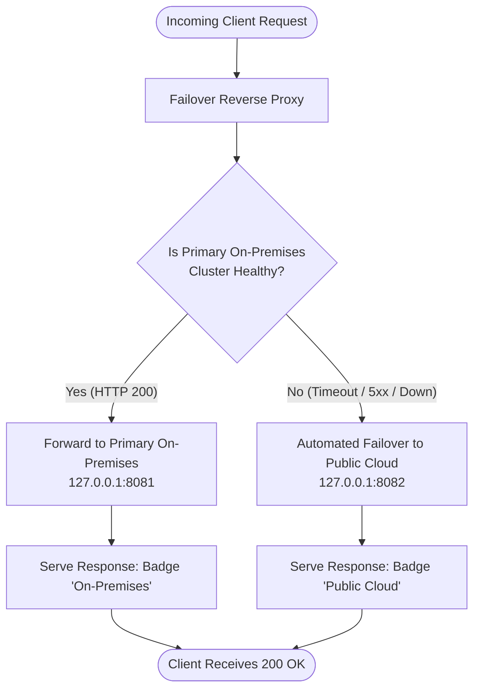

# System Architecture & Technical Design

This document details the complete architectural design of the **Distributed Visitor Counter Web Application** built with Flask, Redis, Docker, and Kubernetes, featuring Horizontal Pod Autoscaling (HPA) and a Hybrid Cloud active-passive failover topology.

---

## 1. High-Level System Architecture

```mermaid
flowchart TD
    User([🌐 End Users / Web Traffic]) --> LB{Global Failover Controller / Reverse Proxy<br/>Port 8080}

    subgraph OnPrem [🏢 Cluster 1: On-Premises Minikube (Primary)]
        NodePort1[NodePort Service :30081 / Port 8081]
        Ingress1[Kubernetes Service: visitor-counter-service]
        PodWeb1[Pod: Flask Web App Replicas]
        PodRedis1[(Pod: Redis In-Memory Store)]
        HPA1[Horizontal Pod Autoscaler HPA]

        NodePort1 --> Ingress1
        Ingress1 --> PodWeb1
        PodWeb1 <-->|TCP 6379| PodRedis1
        HPA1 -.->|Monitors CPU & Scales| PodWeb1
    end

    subgraph PublicCloud [☁️ Cluster 2: Public Cloud Minikube (Secondary / Failover)]
        NodePort2[NodePort Service :30082 / Port 8082]
        Ingress2[Kubernetes Service: visitor-counter-service]
        PodWeb2[Pod: Flask Web App Replicas]
        PodRedis2[(Pod: Redis In-Memory Store)]

        NodePort2 --> Ingress2
        Ingress2 --> PodWeb2
        PodWeb2 <-->|TCP 6379| PodRedis2
    end

    LB -->|Active Traffic (Healthy)| NodePort1
    LB -.->|Automated Failover (Primary Down)| NodePort2
    LB -.->|Periodic Health Checks /healthz| NodePort1
```

---

## 2. Kubernetes Pod & Namespace Architecture

Within each Kubernetes cluster, the components reside in dedicated namespaces (`visitor-counter` or `visitor-counter-hybrid`), fully isolated with microservice boundaries.

```mermaid
graph LR
    subgraph K8sNamespace [Namespace: visitor-counter]
        direction TB
        subgraph Config [Configuration]
            CM[ConfigMap: visitor-counter-config<br/>REDIS_HOST, PORT, ENV]
        end

        subgraph WebTier [Web Application Tier]
            ServiceWeb[Service: visitor-counter-service<br/>Type: NodePort :30080]
            DeploymentWeb[Deployment: visitor-counter-web<br/>Replicas: 2 to 10]
            Pod1[Pod: web-pod-1]
            Pod2[Pod: web-pod-2]
            PodN[Pod: web-pod-N (HPA)]
        end

        subgraph CacheTier [Cache / Persistence Tier]
            ServiceRedis[Service: redis-service<br/>Type: ClusterIP :6379]
            DeploymentRedis[Deployment: redis-deployment<br/>Replicas: 1]
            PodRedis[Pod: redis-7.2-alpine]
            Volume[Volume: redis-storage<br/>emptyDir / PersistentVolume]
        end

        ServiceWeb --> DeploymentWeb
        DeploymentWeb --> Pod1
        DeploymentWeb --> Pod2
        DeploymentWeb -.-> PodN

        Pod1 -->|Read / Write Count| ServiceRedis
        Pod2 -->|Read / Write Count| ServiceRedis
        PodN -->|Read / Write Count| ServiceRedis
        ServiceRedis --> DeploymentRedis
        DeploymentRedis --> PodRedis
        PodRedis --> Volume
        CM -.->|Env Injection| Pod1
        CM -.->|Env Injection| Pod2
    end
```

---

## 3. Horizontal Pod Autoscaler (HPA) Dynamic Feedback Loop

The autoscaler monitors pod CPU utilization through the Kubernetes Metrics Server and adjusts replica counts dynamically:

```mermaid
sequenceDiagram
    autonumber
    actor Client as Stress Test Clients
    participant Service as NodePort Service
    participant Pods as Flask Web Pods (Min: 2)
    participant Metrics as Kubernetes Metrics Server
    participant HPA as Horizontal Pod Autoscaler
    participant RS as ReplicaSet Controller

    Client->>Service: High Concurrent Requests (/stress)
    Service->>Pods: Distributes CPU-intensive work
    Pods->>Pods: CPU spike (> 50% target threshold)
    loop Every 15s
        Metrics->>Pods: Scrapes container metrics
        HPA->>Metrics: Queries average CPU utilization
    end
    Note over HPA: Observed CPU: 82% > Target: 50%
    HPA->>RS: Desired Replicas = ceil(2 * (82 / 50)) = 4 pods
    RS->>Pods: Launches new pod replicas (scale-up)
    Note over Pods: Workload distributed across 4-6 pods; CPU stabilizes below 50%
    Note over Client: Stress load stops
    loop Stabilization Window (60s)
        HPA->>RS: Decreases replica count back to Min: 2 (scale-down)
    end
```

---

## 4. Hybrid Cloud Active-Passive Failover Flowchart


